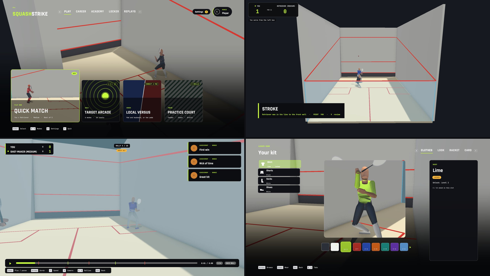

# Re:SquashStrike

A squash game for PC, built in Unity 6. Play a match against the AI or a friend, or climb a career tour. You can also warm up on your own, chase targets, learn the rules in the Academy, and watch your rallies back.

## Download and play (Windows)

1. Open **[Releases](../../releases/latest)** and download `Re-SquashStrike-Windows.zip`.
2. Unzip it anywhere, keeping all the files together in their folder.
3. Double-click **`reSquashStrike.exe`**.

It runs on Windows 10 or 11 (64-bit), with a keyboard and mouse or a gamepad. Nothing to install.

> Windows may show "Windows protected your PC" because the game isn't signed. Click **More info**, then **Run anyway**.

## What's in it

- **Quick Match**: one match against the AI. Pick a personality (Retriever, Attacker, Shot-maker or Grinder) and Easy, Medium or Hard.
- **Local Versus**: two players on one screen (keyboard and pad, or two pads).
- **Career**: create a player and climb a world ranking through tournaments.
- **Target Arcade**: score-chasing challenges with targets on the walls and the floor.
- **Practice Court**: free play on your own with the ball in your hand, or switch on the feeder from the Coach tray.
- **Academy**: short lessons on the controls and the rules, with quizzes where you make the call.
- **Replay Theatre**: every match is saved. Watch it back in slow motion from any camera, with highlights.
- **Locker Room**: kit and racket colours you earn by playing. Cosmetic only.
- **Lets and strokes**: a real referee. Ask for a let when you are blocked, or switch let calls off in Settings > Gameplay.
- **A glass-court arena**: a full crowd that hushes in a rally and applauds after it, an "ooh" at a tin, a cheer for a game. You get a big screen, court lights, a game-ball chip and a rally counter, and the ball leaves a mark wherever it hits.
- **Six courts**: Show Court (a wood-panelled wintergarden), Club Court, Desert Night (the pyramids behind the glass), Station Hall, City Rooftop and Arena. Choose one in Quick Match or Local Versus; Career events move up them as they get bigger.
- **Your look**: a male or female athlete (models by Quaternius, CC0), skin tone, hair style and colour, plus your kit and racket.
- **Settings**: change your keys and pad buttons, pick the match camera (back wall, high, low glass), the arena's detail (Settings > Video > Venue), the crowd's volume, and more.

## Controls

| Action | Keyboard and mouse | Gamepad |
|---|---|---|
| Move | WASD | left stick |
| Aim | mouse | right stick |
| Hit | hold left mouse, let go as the ball arrives | hold A, let go |
| Pick the shot | aim high for a lob, middle for a drive, low for a drop or kill | |
| Straight or cross-court | aim at your half of the front wall for straight, the other half for cross | |
| Harder shot | hold longer before you let go | |
| Boast | tap E | RB |
| Dive | Space | B |
| Sprint | Shift | LB |
| Serve | tap for a lob serve, hold for a hard serve | |
| Ask for a let | right click (when LET? shows) | Y |
| Replay the last call | V | View |
| Coach tray (practice) | Tab | View |
| Pause | Esc | Start |

Get to the ball early and let go on time: the ring flashes on a great hit. The small dot on the front wall shows the line your shot will take.

You can change these keys and buttons in **Settings > Controls > Change keys**.

## Building from source

- Unity **6000.3** (Unity 6 LTS) with the Universal Render Pipeline. Open this folder in Unity Hub.
- The game scenes are in `Assets/Scenes`. A Windows build is made by `SquashGame.Editor.BuildPlayer.BuildWindows`.
- The simulation (`Assets/SquashSim`) is plain C# with no UnityEngine references. It is deterministic, so replays are just recorded input.
- Checks: EditMode and PlayMode tests in Unity, `Tools/SimParity` (.NET 8; bit-identical with the original HTML lab), and `Tools/MatchBench` for AI balance (`--balance`), the let survey (`--let-survey`) and replay checks (`--verify-replays`). The simulation checks also run on GitHub Actions on every push (`.github/workflows/sim.yml`).

## Licence

MIT. See [LICENSE](LICENSE).

The engine's build history is in [DEVLOG.md](DEVLOG.md).
